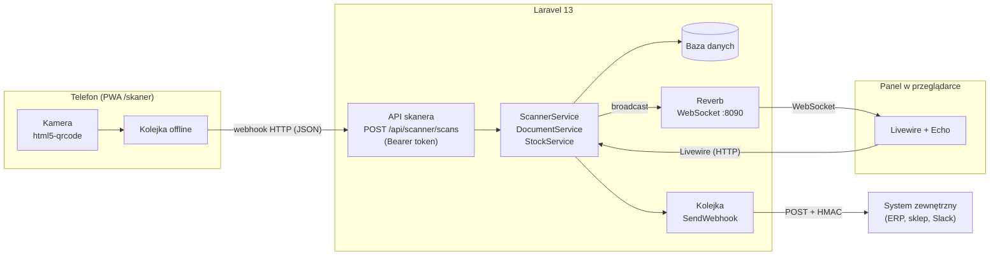
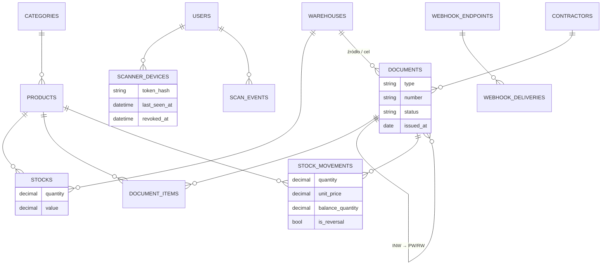

# Regał WMS

**Projekt i realizacja aplikacji webowej do zarządzania gospodarką magazynową** – praca inżynierska.

Aplikacja webowa (Laravel 13 + Livewire 4) do prowadzenia ewidencji magazynowej z dokumentami PZ, WZ, PW, RW, MM i INW, wyceną metodą średniej ważonej, kartoteką ruchów oraz **telefonem działającym jak bezprzewodowy skaner kodów** – skany trafiają webhookiem na serwer i na żywo (WebSocket) do panelu w przeglądarce.

## Funkcje

| Obszar | Co robi |
|---|---|
| Dokumenty | PZ, WZ, PW, RW, MM, INW · szkic → zatwierdzenie → storno · ciągła numeracja `PZ/2026/11/0001` · wydruk PDF |
| Stany | ilość i wartość per magazyn · cena średnia ważona · alerty stanu minimalnego · eksport CSV |
| Kartoteka | pełna historia ruchów towaru z saldem po każdej operacji |
| Inwentaryzacja | arkusz spisu ze stanem ewidencyjnym · szybkie „zgodne” / „0” · różnice rozliczane automatycznie dokumentami PW (nadwyżki) i RW (niedobory) · **blokada magazynu** na czas spisu |
| Skaner mobilny | PWA na telefon · kamera czyta QR i EAN/Code128 · tryb „dodaj” i „sprawdź stan” · kolejka offline · wibracja i dźwięk |
| Na żywo | Laravel Reverb (WebSocket) – pozycje, pulpit, listy i stany odświeżają się bez przeładowania |
| Czytnik USB | pole czytnika w dokumencie (czytnik działa jak klawiatura + Enter) |
| Etykiety | arkusz A4 z kodami QR towarów (`RGL:<indeks>`) i półek (`RGL:L:<magazyn>:<regał>:<półka>:<pole>`) |
| Plan magazynu | konfigurator serii regałów (prefiks, numeracja, sufiks), plan hali z przeciąganiem, front regału z półkami i zajętością, „gdzie leży towar” w dokumentach, PDF, karcie towaru i skanerze |
| Kolory magazynów | każdy magazyn ma kolor z palety (wybór w edycji magazynu); kolorowy znacznik przy kodzie w stanach, dokumentach, karcie towaru, wyszukiwarce, na planie i w skanerze |
| Praca magazyniera | szybkie akcje na pulpicie, lista „Do dokończenia”, wyszukiwarka `Ctrl+K` „Gdzie leży towar?”, tryb telefonu „Rozmieść” (półka → towary) |
| Webhooki | powiadomienia HTTP do systemów zewnętrznych, podpis HMAC-SHA256, ponawianie, dziennik doręczeń |
| Role i uprawnienia | RBAC: 16 uprawnień, role z poziomem hierarchii, macierz uprawnień, role własne · zarządzanie tylko „w dół” |

## Architektura



Przepływ skanu: telefon wysyła kod → serwer znajduje towar (QR `RGL:SKU`, indeks lub EAN) → dopisuje pozycję do dokumentu wybranego jako cel skanera → rozgłasza `items.changed` na kanale `documents.{id}` i `scan.received` na kanale `scanner.{userId}` → otwarty edytor dokumentu podświetla nowy wiersz. Brak serwera WebSocket nie blokuje skanu (`App\Support\Live` – łagodna degradacja).

### Model danych



### Reguły gospodarki magazynowej

- **Wycena – średnia ważona.** Stan przechowuje ilość i wartość; cena średnia = wartość / ilość. Przychody (PZ, PW) po cenie z dokumentu, rozchody (WZ, RW, MM) po bieżącej cenie średniej.
- **Atomowość.** Zatwierdzenie i storno to jedna transakcja z blokadą wierszy stanu (`SELECT … FOR UPDATE`). Brak stanu przy rozchodzie = odrzucenie całego dokumentu.
- **Kartoteka append-only.** Każda zmiana stanu to nowy wiersz `stock_movements` z saldem po operacji. Storno nie usuwa ruchów – dopisuje ruchy odwrotne po cenach pierwotnych.
- **Numeracja** nadawana przy zatwierdzeniu, ciągła w obrębie typu i miesiąca (licznik blokowany w transakcji).
- **Inwentaryzacja.** Pozycje niepoliczone nie zmieniają stanu. Przy zatwierdzeniu stan ewidencyjny jest odczytywany ponownie, a różnice księgowane PW/RW powiązanymi z INW.
- **Zamrożenie magazynu.** Dopóki spis (szkic INW) jest otwarty, w tym magazynie nie można tworzyć ani zatwierdzać innych dokumentów, wykonywać storna ani otworzyć drugiego spisu. Wyjątkiem są PW/RW generowane przez rozliczaną inwentaryzację.
- **Stan minimalny** dotyczy sumy we wszystkich magazynach – ta sama definicja (`Product::belowMinimum()`) na pulpicie, w stanach i w webhooku `stock.low`.

### Role i uprawnienia (RBAC)

| Rola | Poziom | Zakres |
|---|---|---|
| Administrator | 100 | wszystko (rola wbudowana, nieedytowalna) |
| Kierownik magazynu | 50 | dokumenty z INW i stornem, kartoteki, konta magazynierów |
| Magazynier | 10 | dokumenty operacyjne, skaner |
| Księgowość (podgląd) | 5 | podgląd dokumentów i stanów, eksport CSV |

Zasady hierarchii: konto lub rolę można zmieniać tylko, gdy ma niższy poziom niż własny; nowej roli można nadać wyłącznie uprawnienia, które się posiada. Uprawnienia (`App\Enums\Ability`) są jednocześnie bramkami Laravel Gate – trasy, menu i akcje są nimi chronione.

Kod: [`app/Services/Inventory/StockService.php`](app/Services/Inventory/StockService.php), [`app/Services/Documents/DocumentService.php`](app/Services/Documents/DocumentService.php).

## Uruchomienie w Dockerze (zalecane)

Wymagany tylko Docker Desktop. Cały system startuje jedną komendą:

```bash
docker compose up -d --build
```

Panel: http://localhost:8000 (konta demo niżej). Przy pierwszym starcie usługa `init` wykonuje migracje i wgrywa dane demonstracyjne do pustej bazy.

| Kontener | Rola |
|---|---|
| `web` | nginx – jedyny port na zewnątrz (`:8000`); PHP → `app`, WebSocket `/app` → `reverb` |
| `app` | PHP-FPM 8.4 z aplikacją |
| `reverb` | serwer WebSocket (Laravel Reverb) – aktualizacje na żywo |
| `queue` | kolejka – doręczanie webhooków z ponawianiem |
| `init` | jednorazowo: migracje + dane demo |
| `db` | PostgreSQL 17 (dane w wolumenie `pg-data`, z hosta: `localhost:5433`, użytkownik `regal` / `regal`) |
| `tunnel` *(profil)* | Cloudflare Tunnel – publiczny adres HTTPS dla kamery telefonu |
| `adminer` *(profil)* | podgląd bazy: http://localhost:8081 |

```bash
docker compose --profile tunnel up -d   # + tunel HTTPS; adres: docker compose logs tunnel
docker compose --profile tools up -d    # + Adminer
docker compose logs -f app queue reverb # logi
docker compose down                     # stop (dane zostają)
docker compose down -v                  # stop + usunięcie bazy
```

Plik `.env` jest wspólny dla Dockera i trybu lokalnego. Na świeżym klonie: `cp .env.example .env`, a klucz aplikacji wygeneruj bez lokalnego PHP:

```bash
docker run --rm php:8.4-cli php -r "echo 'base64:'.base64_encode(random_bytes(32)), PHP_EOL;"
```

i wklej wynik jako `APP_KEY=` w `.env`.

## Uruchomienie lokalne (bez Dockera)

Wymagania: PHP 8.3+ (rozszerzenia: pdo_sqlite lub pdo_pgsql, mbstring, bcmath, intl, gd, zip), Composer, Node.js 20+.

```bash
composer install
npm install
cp .env.example .env
php artisan key:generate
php artisan reverb:install   # klucze REVERB_* (lub uzupełnij ręcznie w .env)
php artisan migrate --seed
npm run build
composer dev                 # HTTP :8000 (LAN), Reverb :8090, kolejka, Vite
```

Panel: http://localhost:8000 · konta demonstracyjne (hasło `haslo1234`): `admin@regal.test`, `kierownik@regal.test`, `magazynier@regal.test`, `ksiegowosc@regal.test`.

Domyślnie baza SQLite (`database/database.sqlite`). PostgreSQL – ustaw `DB_*` w `.env` (wersja w Dockerze korzysta z PostgreSQL 17).

> Port 8080 bywa zajęty przez Docker Desktop, dlatego Reverb działa na **8090**.

## Telefon jako skaner

1. Panel → **Skanery mobilne → Sparuj telefon** – pojawi się QR z jednorazowym kodem (ważny 10 min).
2. Zeskanuj go aparatem telefonu – otworzy się `/skaner` z wypełnionym kodem → **Połącz**. Telefon dostaje własny token (w bazie tylko skrót SHA-256).
3. W dokumencie kliknij **Podłącz skaner** (albo wybierz dokument w telefonie).
4. Skanuj etykiety QR lub kody EAN – pozycje pojawiają się w panelu na żywo. Ten sam kod w ciągu 1,5 s jest ignorowany (jak spust fizycznego czytnika).
5. Na Androidzie/iOS: menu przeglądarki → **Dodaj do ekranu głównego** – skaner działa jak aplikacja (PWA).

**HTTPS.** Przeglądarka mobilna udostępnia kamerę tylko w bezpiecznym kontekście. W Dockerze:

```bash
docker compose --profile tunnel up -d
```

– adres `https://….trycloudflare.com` jest odczytywany automatycznie i trafia do kodu QR parowania (WebSocket działa przez ten sam adres). Bez Dockera: `cloudflared tunnel --url http://localhost:8000` i w `.env`: `SCANNER_PUBLIC_URL=https://<adres>.trycloudflare.com`. Uwaga: tunel wystawia aplikację publicznie w internecie – wyłączaj go po pokazie. Alternatywa na czas testów: w Chrome na Androidzie `chrome://flags/#unsafely-treat-insecure-origin-as-secure` z adresem `http://<IP-komputera>:8000`. Bez kamery kody można wpisywać ręcznie.

### API skanera

| Metoda | Ścieżka | Opis |
|---|---|---|
| POST | `/api/scanner/pair` | `{code, name}` → `{token}` (jednorazowy kod z panelu) |
| GET | `/api/scanner/me` | urządzenie, użytkownik, aktywny dokument |
| GET | `/api/scanner/documents` | otwarte szkice do wyboru |
| POST | `/api/scanner/target` | `{document_id \| null}` – cel skanów |
| POST | `/api/scanner/scans` | `{code, quantity?, mode: add\|lookup}` → wynik skanu |
| DELETE | `/api/scanner/session` | odłączenie urządzenia |

```bash
curl -X POST http://localhost:8000/api/scanner/scans \
  -H "Authorization: Bearer rgl_…" -H "Content-Type: application/json" \
  -d '{"code":"RGL:TAS-48","quantity":"12"}'
```

## Webhooki wychodzące

Panel → **Webhooki** (administrator). Zdarzenia: `document.approved`, `document.cancelled`, `stock.low`, `scan.received`.

Każde żądanie to `POST` z JSON i nagłówkami `X-Regal-Event`, `X-Regal-Delivery`, `X-Regal-Timestamp`, `X-Regal-Signature`. Weryfikacja u odbiorcy:

```php
$expected = 'sha256=' . hash_hmac('sha256', $timestamp . '.' . $body, $secret);
$valid = hash_equals($expected, $signature) && abs(time() - (int) $timestamp) < 300;
```

Odpowiedź 2xx = doręczono. W przeciwnym razie 5 prób z rosnącym odstępem (10 s → 10 min); historia w panelu. Wymaga działającej kolejki (`queue:listen` w `composer dev`).

## Testy

Wystarczy Docker (bez PHP i Composera na komputerze):

```bash
docker compose --profile test run --rm tests      # SQLite w pamięci
docker compose --profile test run --rm tests-pg   # PostgreSQL 17, osobna baza regal_test (baza aplikacji nietknięta)
```

Z lokalnym PHP 8.4 i zależnościami dev: `php artisan test`.

46 testów funkcjonalnych (PHPUnit, SQLite w pamięci; zestaw przechodzi też na PostgreSQL): wycena średnią ważoną, rozchód ponad stan (rollback), MM, INW → PW/RW, blokada inwentaryzacyjna, zapis zer w spisie, edycja pozycji, storno, regały i rozmieszczenie, parowanie i API skanera (w tym tryb „Rozmieść” i osobne limity żądań), podpis webhooków, hierarchia ról i uprawnień, kolory magazynów, renderowanie wszystkich stron.

Testy end-to-end (Playwright) – prawdziwa przeglądarka na środowisku Docker, osobne scenariusze dla każdej roli (`tests/e2e/`):

```bash
docker compose up -d
npx playwright install chromium   # jednorazowo
npm run test:e2e                  # reset bazy demo + 15 scenariuszy
npx playwright show-report tests/e2e/report
```

Wyniki audytu ról, znalezione problemy i ich naprawy: [docs/AUDYT-E2E.md](docs/AUDYT-E2E.md).

## Struktura

```
app/
  Enums/                 DocumentType, DocumentStatus, UserRole, Unit, WebhookEvent
  Services/
    Inventory/           StockService – stany i kartoteka (średnia ważona)
    Documents/           DocumentService – cykl życia dokumentu, numeracja, payload
    Scanner/             ScannerService – parowanie, obsługa skanu
    Webhooks/            WebhookDispatcher – podpisy, kolejka
  Events/                zdarzenia WebSocket (Reverb)
  Jobs/SendWebhook.php   doręczenie z ponawianiem
  Http/Controllers/Api/  API skanera
  Livewire/              ekrany panelu
resources/
  views/scanner/         PWA skanera + service worker
  js/scanner.js          logika skanera (kamera, kolejka offline, feedback)
  css/app.css            system projektowy (tokeny, tryb ciemny)
tests/Feature/           testy funkcjonalne
```

Stos: Laravel 13 · Livewire 4 · Alpine.js · Tailwind CSS 4 · Laravel Reverb · html5-qrcode · bacon-qr-code · DomPDF · Lucide.
